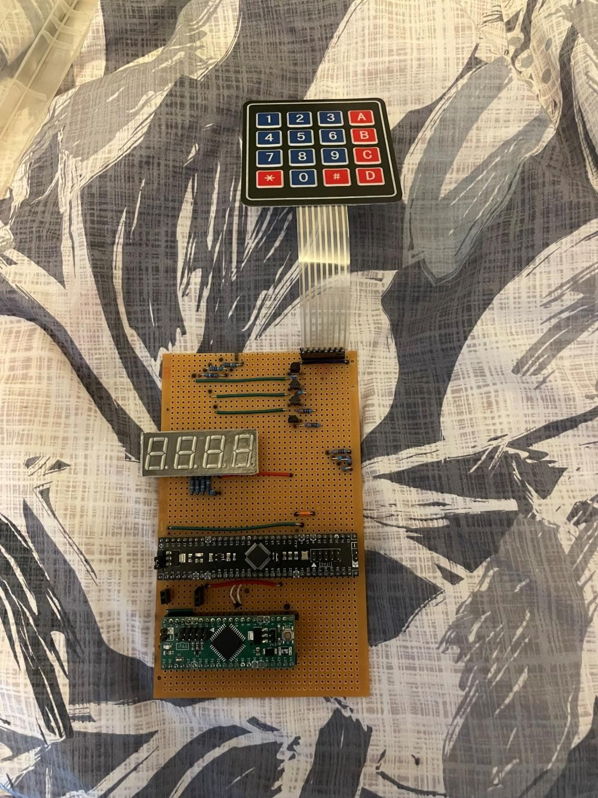
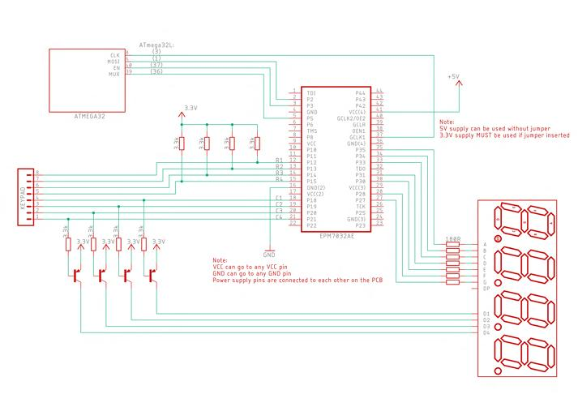
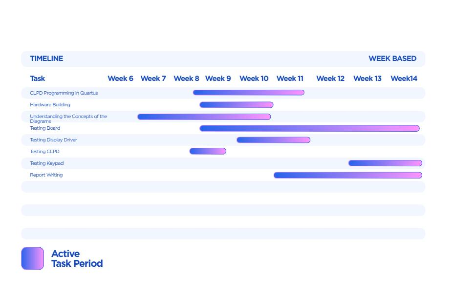

# Hex Keypad Display: ATmega32 + MAX V CPLD over SPI

A microcontroller-and-CPLD "data machine". When you press a key on a 4×4 hex keypad, its value appears on the rightmost of four 7-segment displays, and the digits already showing shift one place to the left. I designed the digital logic, built the hardware on Veroboard and wrote the C firmware.

Built for *UEEEC0010 Design and develop advanced digital systems / UEEIC0012 Develop structured programs to control external devices* (Advanced Diploma of Electronics and Communications Engineering, RMIT, 2026). The budget was $80.



## How it works

The work is split between two chips, and only **three wires** connect them (synchronous serial / SPI):

| Part | Job |
|---|---|
| **ATmega32** (C, Microchip Studio) | Runs the program. It scans the keypad, keeps track of the four digits, and sends one byte at a time over hardware SPI (`SCK`, `MOSI`) plus an enable line (`EN`) |
| **MAX V CPLD** (Verilog, Quartus II) | Hardware interface. It shifts the SPI byte in, decodes it to drive the displays, selects the keypad column, and sends the selected row back on `MUXOUT` |

Each SPI byte carries three fields:

```
 bit:   7   6   5   4   3   2   1   0
      [ row ] [digit] [   hex value   ]
       Q7 Q6   Q5 Q4   Q3  Q2  Q1  Q0
```

### Inside the CPLD (`cpld/MYCLPD.v`)

1. **8-bit shift register**: on each `CLK` edge, `MOSI` shifts in at Q0 and every bit moves one place toward Q7.
2. **7-segment decoder**: Q3–Q0 are decoded to segments a–g from K-map-minimised equations. Every segment is ANDed with `EN`, so the display is blank while a new byte is shifting in. That stops the display flickering with half-loaded bits.
3. **Walking-zero decoder**: Q5–Q4 select one of `C1`–`C4` (active-low). These drive the PNP transistors for the four displays, and also drive the keypad columns.
4. **4-to-1 multiplexer**: Q7–Q6 pick one keypad row (`R1`–`R4`) and send it back to the ATmega32 on `MUXOUT`.

### Firmware

- **Display driver** (`firmware/display_driver`): sends four bytes in a loop to multiplex the displays. It holds each digit with a short persistence-of-vision delay and drops `EN` while each byte is loading. This was the first step, showing 1-2-3-4.
- **Keypad driver** (`firmware/keypad_driver`): the final program.
  - It loops through all **16 scan positions** (4 rows × 4 columns). Each SPI byte refreshes one display digit and selects one key position at the same time, so the display and the keypad are scanned together.
  - It reads `MUXOUT` on `PD2` to see whether the key at that position is pressed. A lookup table (`data[16]`) maps the scan position to the key's hex value.
  - On a new press, the digits shift left and the new value goes in on the right.
  - A `key_hold` flag stops one long press from filling every digit with the same number. The keypad stays locked until all keys are released.

## Hardware



| Part | Details |
|---|---|
| Microcontroller | ATmega32 (8-bit AVR), hardware SPI |
| CPLD | Intel/Altera MAX V `5M80ZE64C5` |
| Display | 4-digit 7-segment, multiplexed, 180 Ω segment resistors, 4 × BC559 PNP digit drivers |
| Keypad | 4×4 membrane keypad with 3.3 kΩ pull-ups on the rows |
| Build | Veroboard and jumper wires |

### CPLD pin assignments

| Signal | Pin | Signal | Pin |
|---|---|---|---|
| `CLK` | 7 | `MOSI` | 22 |
| `EN` | 13 | `MUXOUT` | 12 |
| `A B C D E F G` | 55 53 58 60 61 54 56 | `C1 C2 C3 C4` | 37 38 42 40 |
| `R1 R2 R3 R4` | 33 34 35 36 | `Q[7:0]` (debug) | 25–32 |

## Testing

- **Each CPLD block on its own:** I simulated the shift register, decoder, walking-zero decoder and multiplexer in Quartus.
- **Whole CPLD:** I simulated four serial bytes (`0x03`, `0x14`, `0x25`, `0x36`). Each byte selected the correct digit (C4 → C1) and showed the right segments for 3, 4, 5 and 6.
- **Display driver:** the firmware showed 1-2-3-4 across all four displays on the real board.
- **Keypad driver:** on the finished board, key presses appeared on the right and shifted the earlier digits left. Holding a key entered it only once.

## Files

| Path | Contents |
|---|---|
| `cpld/MYCLPD.v` | CPLD logic: shift register, 7-segment decoder, walking-zero decoder, row multiplexer |
| `cpld/MYCLPD.qpf`, `.qsf` | Quartus II project and pin assignments |
| `firmware/display_driver/main.c` | SPI display multiplexing test (shows 1 2 3 4) |
| `firmware/keypad_driver/main.c` | Final firmware: keypad scanning, shift-left display, key-hold lock |
| `docs/` | Build photo, schematic, Gantt chart |

## Planning



## What I learned

- Splitting a system between hardware (CPLD) and software (microcontroller), and designing the interface between them.
- Using hardware SPI on an AVR, and building the matching shift register in Verilog.
- Multiplexing displays and scanning a keypad with the same signals, and using persistence of vision to keep the display steady.
- Software debouncing and key-hold logic so presses aren't repeated.
- Hand-building and debugging a mixed-signal board on Veroboard.
